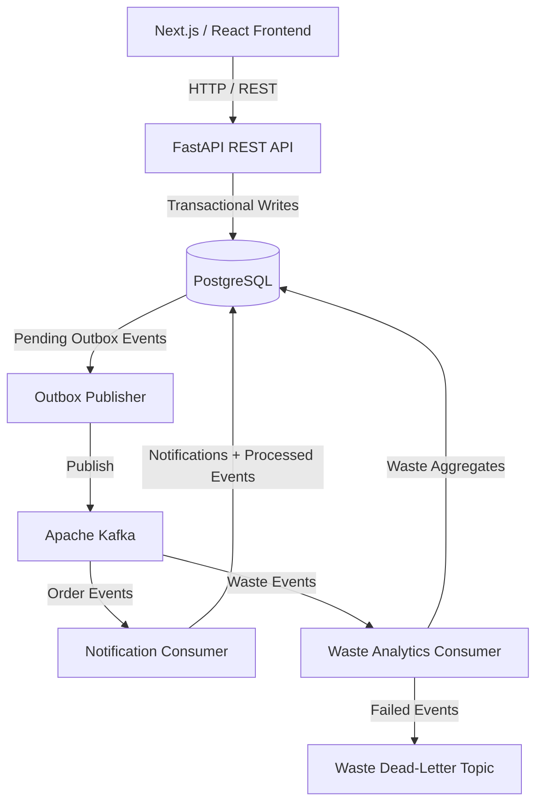
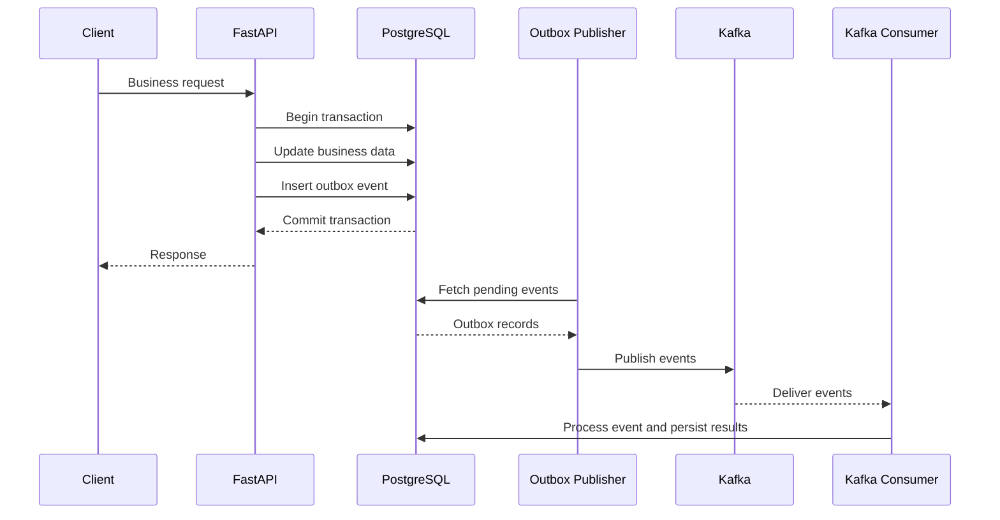
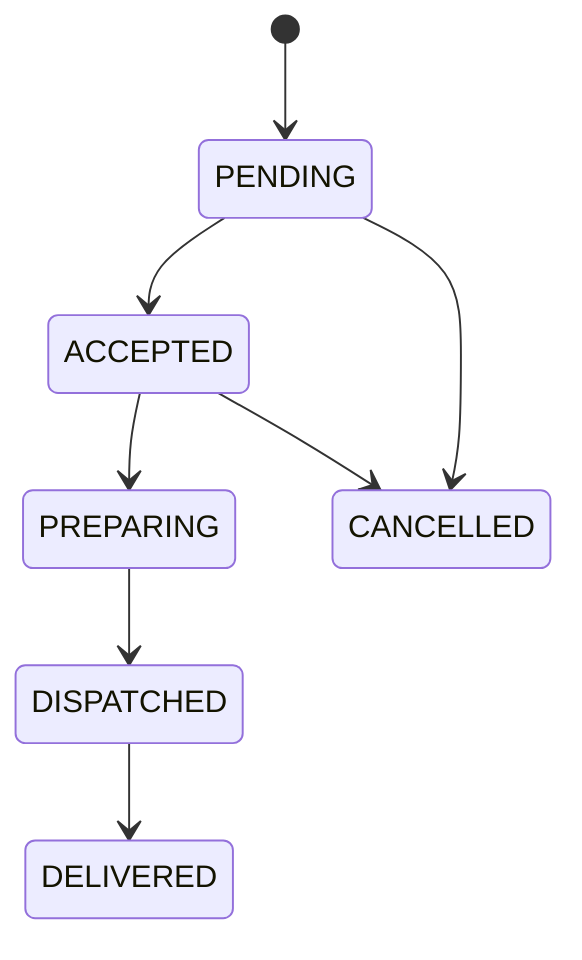

# 🌸 BloomBalance

### An Event-Driven Flower Supply Chain & Waste Management Platform

BloomBalance is a full-stack flower marketplace and inventory management platform connecting flower growers and florists, with a focus on reducing flower waste through better inventory visibility, efficient order fulfillment, and surplus management.

Built with **FastAPI, PostgreSQL, Apache Kafka, Next.js, and Docker**, BloomBalance demonstrates event-driven architecture, transactional consistency, concurrency-safe inventory allocation, and reliable asynchronous processing.

## The Problem

Flowers are highly perishable, and delays in distribution can result in inventory losses.

Growers need visibility into harvested stock and opportunities to sell flowers before they expire. Florists need a reliable way to discover available inventory, place orders, and track fulfillment.

BloomBalance addresses these challenges through:

- A digital marketplace connecting growers and florists
- Harvest batch and inventory management
- Expiry-aware inventory allocation
- Order fulfillment and notifications
- Surplus flower management
- Waste tracking and analytics

## Key Features

### 🌱 Grower Dashboard

- Manage flower catalogs and harvest batches
- Track available and reserved inventory
- Review and fulfill incoming orders
- Manage surplus flower listings
- Monitor flower waste through BloomTrace analytics

### 💐 Florist Marketplace

- Browse available flowers
- Add flowers to a shopping cart
- Place orders with growers
- Track orders through fulfillment
- Receive order notifications

### 📦 Inventory & Order Management

- First Expiry, First Out (FEFO) inventory allocation
- PostgreSQL row-level locking for concurrent order acceptance
- Inventory reservation and movement tracking
- Inventory restoration during eligible order cancellations
- Order lifecycle validation
- Expired inventory and waste recording

### 📊 BloomTrace — Waste Analytics

- Track wasted and expired flower inventory
- Process inventory waste events asynchronously
- Aggregate waste quantities for reporting
- Provide organization-level waste insights
- Support visibility into inventory losses

## Technology Stack

| Layer           | Technologies                                |
| --------------- | ------------------------------------------- |
| Frontend        | Next.js, React, TypeScript, Tailwind CSS    |
| Backend         | Python, FastAPI, SQLAlchemy                 |
| Database        | PostgreSQL                                  |
| Event Streaming | Apache Kafka, Confluent Kafka Python Client |
| Migrations      | Alembic                                     |
| Infrastructure  | Docker, Docker Compose                      |
| Testing         | Pytest, HTTPX                               |

## System Architecture



### Architecture Components

**FastAPI Backend**

Handles synchronous business operations, including inventory management, order placement, order acceptance, order lifecycle transitions, and waste recording.

**PostgreSQL**

Stores transactional business data, including organizations, flower batches, inventory balances, orders, allocations, outbox events, notifications, and waste analytics.

**Apache Kafka**

Decouples asynchronous event processing from synchronous API operations.

**Outbox Publisher**

Reads pending outbox records from PostgreSQL and publishes events to Kafka.

**Notification Consumer**

Processes order events and creates notifications while tracking processed event identifiers.

**Waste Analytics Consumer**

Processes inventory waste events and updates aggregated waste analytics. Failed events can be routed to a dead-letter topic.

## Event-Driven Architecture

### Transactional Outbox Pattern

BloomBalance implements the transactional outbox pattern to coordinate database updates and Kafka event publishing.

When a business operation generates an event:

1. The backend performs the business operation within a PostgreSQL transaction.
2. A corresponding event is inserted into the `outbox_events` table within the same transaction.
3. Both changes are committed atomically.
4. The outbox publisher reads pending events.
5. The publisher sends events to Kafka.
6. Kafka consumers process events independently.



This approach avoids publishing events for rolled-back transactions and allows event publishing to be retried independently of the original API request.

### Kafka Topics

| Topic                              | Purpose                        |
| ---------------------------------- | ------------------------------ |
| `bloombalance.orders`              | Order lifecycle events         |
| `bloombalance.inventory.waste`     | Inventory waste events         |
| `bloombalance.inventory.waste.dlq` | Failed waste-processing events |

### Idempotent Event Processing

Kafka messages may be delivered more than once.

BloomBalance uses event identifiers and database constraints to prevent duplicate business effects during event reprocessing.

The notification consumer tracks processed events using the `processed_events` table.

The waste analytics consumer updates aggregated waste records and supports dead-letter handling for failed messages.

This design supports reliable processing under an at-least-once delivery model.

## Concurrency-Safe Inventory Allocation

Flower inventory is allocated using **First Expiry, First Out (FEFO)**, prioritizing batches closest to expiration.

To prevent concurrent orders from allocating the same inventory, BloomBalance uses PostgreSQL row-level locking.

### Allocation Workflow

1. Lock the pending order.
2. Retrieve the requested order items.
3. Identify eligible inventory belonging to the seller.
4. Prioritize inventory by expiration date.
5. Lock inventory rows using `SELECT ... FOR UPDATE SKIP LOCKED`.
6. Allocate the required quantities.
7. Update available and reserved inventory.
8. Persist allocations and transition the order to `ACCEPTED`.

If sufficient eligible inventory cannot be allocated, the operation fails without partially committing the reservation.

### Why FEFO?

Unlike FIFO, which prioritizes the oldest received inventory, FEFO prioritizes inventory with the earliest expiration date.

This is particularly relevant for perishable products such as flowers.

## Order Lifecycle Management

BloomBalance implements a state-based order fulfillment workflow.



Order transitions are validated by the backend.

Inventory reservations are coordinated with order acceptance and cancellation to preserve stock consistency.

## Database Design

The database models relationships between growers, florists, flower batches, inventory, orders, and waste.

### Core Entities

| Domain           | Entities                                                                              |
| ---------------- | ------------------------------------------------------------------------------------- |
| Organizations    | Users, Organizations, Organization Members                                            |
| Flower Inventory | Flowers, Flower Batches, Inventory Locations, Inventory Balances, Inventory Movements |
| Orders           | Orders, Order Items, Order Allocations, Deliveries                                    |
| Marketplace      | Surplus Listings, Business Relationships                                              |
| Waste Management | Waste Records, Waste Analytics                                                        |
| Event Processing | Outbox Events, Processed Events, Notifications                                        |

PostgreSQL constraints, foreign keys, and transactions help maintain data integrity across these workflows.

## Local Development

### Prerequisites

- Git
- Docker and Docker Compose
- Node.js and npm

### 1. Clone the Repository

```bash
git clone https://github.com/SwarnaMadhuriP/bloom-balance.git
cd bloom-balance
```

### 2. Configure Backend Environment

Create a `.env` file in the project root:

```env
POSTGRES_DB=bloombalance
POSTGRES_USER=bloombalance
POSTGRES_PASSWORD=change_me
DATABASE_URL=postgresql+psycopg://bloombalance:change_me@db:5432/bloombalance
```

Replace `change_me` with your preferred local database password.

### 3. Start Backend Services

From the project root:

```bash
docker compose up --build -d
```

The Docker Compose configuration runs the FastAPI backend, PostgreSQL, Kafka, and configured background workers.

Apply database migrations:

```bash
docker compose exec api alembic upgrade head
```

Access the interactive FastAPI documentation at:

http://localhost:8000/docs

### 4. Configure the Frontend

Create `frontend/.env.local`:

```env
NEXT_PUBLIC_API_URL=http://localhost:8000
NEXT_PUBLIC_ORGANIZATION_ID=<organization-uuid>
NEXT_PUBLIC_FLORIST_ORGANIZATION_ID=<florist-organization-uuid>
NEXT_PUBLIC_GROWER_ORGANIZATION_ID=<grower-organization-uuid>
```

Replace the UUID placeholders with organization IDs from your local database.

These variables configure the local demo experience. `NEXT_PUBLIC_` values are exposed to the browser and must not contain secrets.

### 5. Start the Frontend

From the project root:

```bash
cd frontend
npm install
npm run dev
```

Open:

http://localhost:3000

### 6. Run Backend Tests

From the project root:

```bash
docker compose exec api python -m pytest tests/ -v
```

The backend has **32 passing automated tests** covering inventory allocation, order workflows, event processing, and related business logic.

### 7. Stop Services

```bash
docker compose down
```

## Repository Structure

```text
bloom-balance/
├── backend/
│   ├── app/
│   ├── alembic/
│   ├── scripts/
│   ├── tests/
│   ├── Dockerfile
│   ├── alembic.ini
│   └── requirements.txt
├── frontend/
│   ├── public/
│   ├── src/
│   ├── package.json
│   └── next.config.ts
├── infrastructure/
├── docker-compose.yml
└── README.md
```

The `infrastructure/` directory is reserved for future deployment configuration.

## Engineering Decisions

| Decision             | Rationale                                                                |
| -------------------- | ------------------------------------------------------------------------ |
| FastAPI              | Python-based REST APIs with typed request handling                       |
| PostgreSQL           | Transactional consistency, relational constraints, and row-level locking |
| Apache Kafka         | Decoupled asynchronous event processing                                  |
| Transactional Outbox | Coordinate database commits and eventual event publishing                |
| Idempotent Consumers | Prevent duplicate business effects during event redelivery               |
| FEFO Allocation      | Prioritize perishable inventory approaching expiration                   |
| Row-Level Locking    | Prevent conflicting concurrent inventory allocations                     |
| Docker Compose       | Reproducible local development environment                               |
| Alembic              | Version-controlled database schema migrations                            |

## Testing

The backend includes **32 passing automated tests**, covering:

- Inventory allocation and reservation
- Concurrent order acceptance
- Order lifecycle transitions
- Invalid order transitions
- Cancellation and inventory restoration
- Event consumer idempotency
- Waste processing and analytics
- Transactional behavior

## Project Status

**Core application development completed.**

Implemented components include the grower dashboard, florist marketplace, inventory management, order fulfillment, Kafka event processing, notifications, surplus management, and BloomTrace analytics.

Cloud deployment is planned.

## Future Improvements

- Deploy the frontend and backend to cloud infrastructure
- Add production observability and monitoring
- Strengthen authentication and role-based authorization
- Improve deployment automation and operational resilience

---

**BloomBalance — Connecting flower growers and florists through smarter inventory management and waste reduction.**
